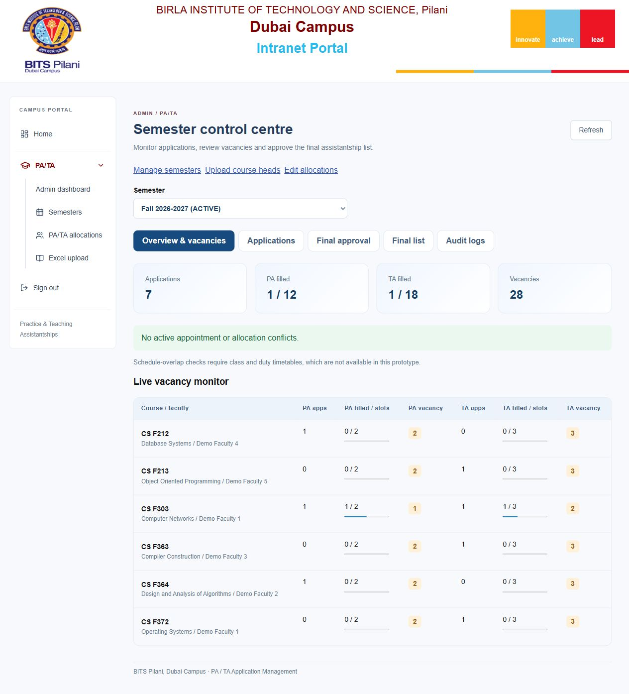
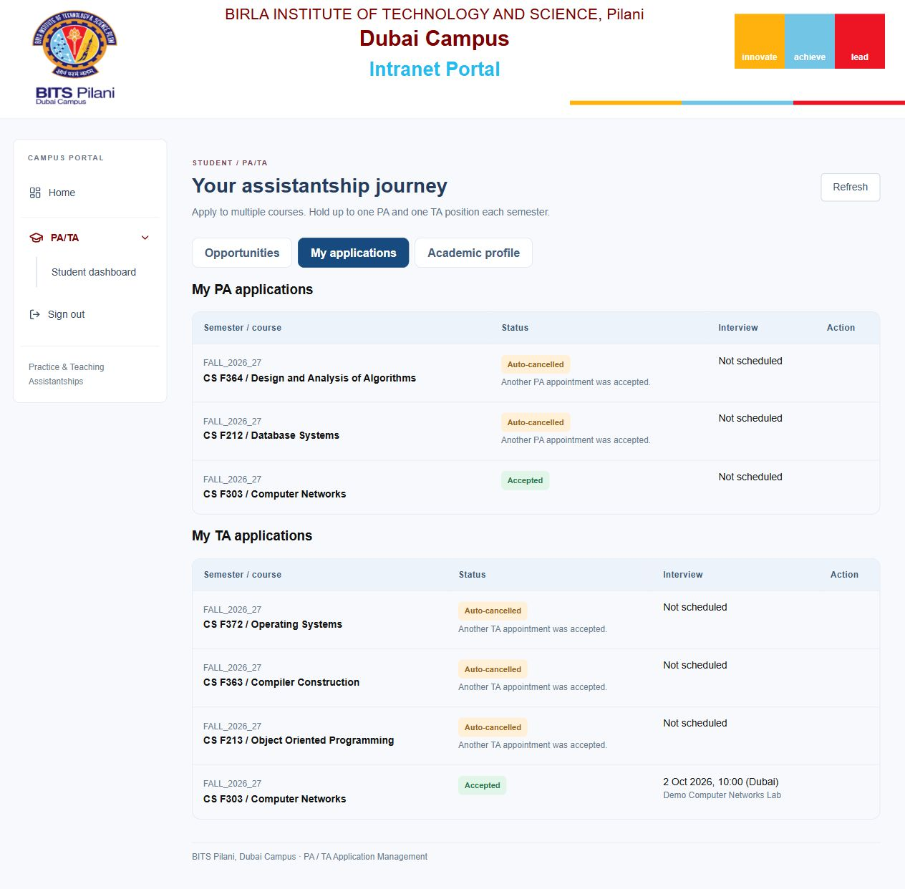

# PA & TA Application Automation

A full-stack portal for **Professional Assistant (PA)** and **Teaching Assistant (TA)** applications. Students apply through generated forms, assigned faculty review and select applicants, and academic administrators approve and export the final list.

The repository includes the **React frontend, Express backend, PostgreSQL migrations, sample workbooks, tests and documentation**. Local setup runs both frontend and API at one address.

## Problem statement coverage

| Requirement | Implementation |
|---|---|
| Create and publish application forms | Semester/course allocations and separate published PA/TA eligibility rules generate opportunities and prefilled forms. |
| Allow eligible students to apply | Academic eligibility and application dates are checked by the backend, with reasons shown to students. |
| Collect and organize applicant information | Applications retain academic/rule snapshots; faculty can compare candidates and record private notes and interviews. |
| Authorized shortlisting and selection | Role checks and current faculty-course assignments protect review, capacity reservations, appointments and Admin approval. |
| Generate the final selected list | Final approval saves a result snapshot used by Excel/PDF exports and student results. |
| University intranet integration | Optional signed institutional identity and academic synchronization interface; live university configuration is still required. |

See the [requirement comparison and limitations](docs/problem-statement-review.md). Demo academic records and course data are synthetic. The repository does not contain a live university connection or a public deployment.

## Run locally

Install **Node.js 24** and Git. In PowerShell:

```powershell
git clone https://github.com/BalaVigneshKannan/PA-TA-Hackathon.git
cd PA-TA-Hackathon
npm.cmd ci
node backend/src/setup-local.js
npm.cmd run db:migrate
npm.cmd run db:seed
npm.cmd run seed:courses -w backend
npm.cmd run build
npm.cmd run preview
```

On macOS/Linux, use `npm` instead of `npm.cmd`. If you already have the project, run the setup commands from the folder containing `package.json`, `backend/` and `frontend/`.

Open **[http://127.0.0.1:5173/login](http://127.0.0.1:5173/login)**. Keep the terminal running; press Ctrl+C to stop it. Use the exact `127.0.0.1` address to match the allowed browser origin.

`setup-local.js` generates private local configuration in `backend/.env` and random credentials in `LOCAL-ACCESS.md`; it preserves an existing configuration. Sign in as Admin with those generated credentials. Create a semester, upload course heads, set slots and publish eligibility rules, then activate it. Faculty sign-in requires a matching assignment. The [setup guide](docs/setup.md) explains each step and troubleshooting.

Local mode uses embedded PGlite, so no separate database installation is needed. Stop the preview before running migrations or seeds against its database. For an existing configured copy, migrate and build without overwriting `.env` or reseeding. For additional synthetic demo accounts and a matching upload workbook, follow the [demo guide](DEMO-GUIDE.md).

## Workflow

1. **Admin:** configure semester dates, course heads, slots, stipend amounts and PA/TA requirements.
2. **Student:** review eligibility, submit applications and track their status.
3. **Faculty:** review, shortlist, interview when required, select and accept appointments within capacity.
4. **Faculty:** submit accepted appointments for approval.
5. **Admin:** finalize the semester and download the preserved final list; students can view their results.

A student can hold one PA and one TA appointment per semester. Accepting an appointment automatically cancels other pending applications for the same role. Authorization and workflow rules are enforced by the API.

## Technology and source

| Component | Stack / location |
|---|---|
| Frontend | React 19, React Router 7, Vite 7; `frontend/src/`. |
| Backend | Node.js ES modules, Express 5; `backend/src/`. |
| Database | PostgreSQL or local PGlite; eight SQL migrations in `database/`. |
| Authentication | Revocable cookie sessions, bcrypt local passwords, optional RS256 intranet assertions. |
| Reports | SheetJS Excel uploads/exports and PDF final lists. |
| Tests | Node test runner and Supertest; `backend/test/`. |
| Hosting examples | Same-host Nginx HTTPS proxy and systemd unit; `deploy/`. |

Exact dependency versions are recorded in `package-lock.json`.

## Useful commands

Run these from the repository root. Use `npm.cmd` in PowerShell if script execution policy blocks `npm`.

| Command | Purpose |
|---|---|
| `npm ci` | Install locked dependencies. |
| `npm run dev` | Vite frontend on port 5173 and API on port 3001. Restart after backend changes. |
| `npm run build` | Compile the frontend. |
| `npm run preview` | Serve the compiled frontend and API together on port 5173. Rebuild after frontend edits. |
| `npm test` | Run isolated backend integration tests. |
| `npm run db:migrate` | Apply pending schema migrations. |
| `npm run db:seed` | Create missing configured accounts; preserve existing passwords. |
| `npm run seed:courses -w backend` | Load the sample core-course master. |
| `npm run seed:demo -w backend` | Create synthetic demonstration accounts and workbook. |
| `npm start` | Start the backend using deployment environment settings. |

The latest local verification passed **59 tests** and the frontend build. See the [verification report](docs/verification.md) for what was checked and its limits.

## Documentation

| Document | Contents |
|---|---|
| [Start here](START-HERE.md) | Short local launch instructions. |
| [Setup guide](docs/setup.md) | Installation, configuration, first semester, demo data and troubleshooting. |
| [Technical overview](docs/technical-overview.md) | Architecture, modules, data model, transactions, authorization and workflow invariants. |
| [API reference](docs/api-reference.md) | Auth, Admin, Faculty and Student endpoints, inputs, transitions and errors. |
| [Deployment guide](docs/deployment.md) | PostgreSQL, HTTPS proxy, service configuration, staging checks, updates and backups. |
| [Intranet integration](docs/intranet-integration.md) | Institutional identity and academic synchronization contract. |
| [Demo guide](DEMO-GUIDE.md) | Role-by-role presentation walkthrough. |
| [Problem statement review](docs/problem-statement-review.md) | Requirement mapping, completed logic and remaining gaps. |
| [Verification](docs/verification.md) | Test/build evidence and startup checks. |
| [Repository submission checklist](docs/submission-checklist.md) | Required repository deliverables and reviewer access. |

## Screenshots

Admin workspace:



Student applications:



These screenshots illustrate the local demonstration, not a live university deployment.

## Deployment and current limits

Follow the [deployment guide](docs/deployment.md) for the supplied Linux/PostgreSQL/Nginx example. The API currently listens on loopback; the proxy must run on the same host. Standalone PostgreSQL, Linux service installation and a live university identity provider have not been verified here. Proxy trust and rate-limit storage need deployment-specific configuration before multiuser production use.

The prototype has no account-creation/password-reset UI, notifications, duty timetable-overlap engine, assignment-replacement workflow or final-result amendment workflow. The PDF exporter has limited Unicode support; Excel preserves Unicode. University policies and authoritative academic data must be supplied for institutional use.

Local credentials, `.env`, dependencies, compiled assets, databases and local backups are excluded from Git. Do not publish generated access files or real student records.
