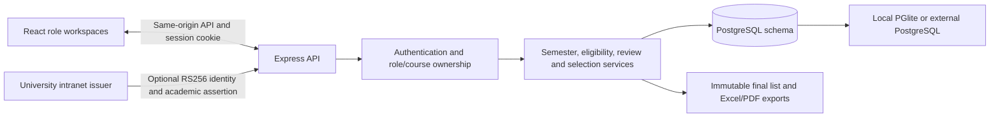
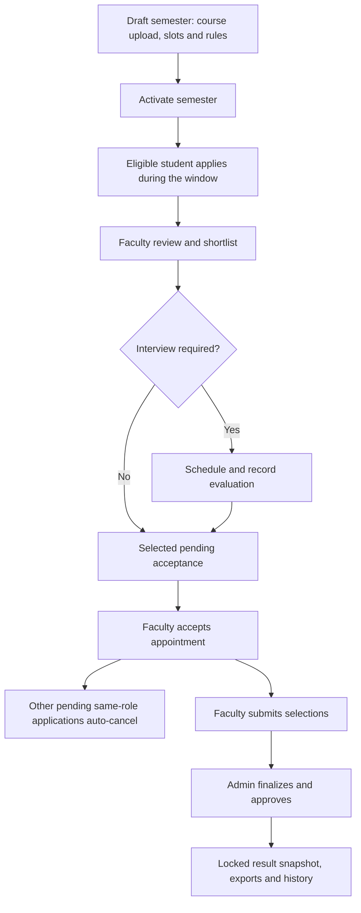

# Technical overview

## Purpose and scope

The portal centralizes Professional Assistant (PA) and Teaching Assistant (TA) applications. Admin configures semesters, course heads, slots and requirements; eligible students apply; assigned faculty review and select; Admin approves a preserved final list. Both the frontend and backend are included.

The university connection is an optional, tested assertion interface. The repository does not include a configured live identity provider, real transcripts or an approved course master. See [problem-statement-review.md](problem-statement-review.md) for the requirements comparison and implementation limits.

## Architecture

Local development runs Vite and Express separately. The compiled preview and production server use Express to serve `frontend/dist` and `/api` from one origin. The server binds to `127.0.0.1`; the documented Linux deployment uses a reverse proxy on the same host.

## Technology and modules

| Layer | Technology and responsibility |
|---|---|
| Frontend | React 19, React Router 7, Lucide icons, Vite 7; role workspaces, generated forms, applicant review, semester setup and reports. |
| API | Node.js ES modules and Express 5; JSON endpoints, authorization, validation and transactional workflow. |
| Data | PostgreSQL SQL through `pg`, or PGlite for local development; versioned additive migrations. |
| Authentication | bcrypt local password hashes, HS256 signed session cookies backed by database sessions, optional RS256 institutional assertions. |
| Uploads/exports | Multer memory uploads, SheetJS Excel processing in a resource-limited worker, basic paginated PDF writer. |
| Verification | Node's test runner, Supertest and isolated PGlite databases. |

Dependencies and their exact versions are recorded in `package-lock.json`; install with `npm ci`.

| Source | Responsibility |
|---|---|
| `frontend/src/main.jsx` | Campus shell, routing, session restoration and local sign-in. |
| `StudentWorkspace.jsx`, `StudentResults.jsx` | Academic profile, opportunities, application forms/tracking and personal results. |
| `FacultyWorkspace.jsx`, `FacultyReview.jsx` | Course authorization, candidate comparison, notes, interview/review actions and selection submission. |
| `AdminWorkflow.jsx`, `Allocations.jsx`, `AdminEligibility.jsx` | Monitoring, course slots, requirements, final approval and reports. |
| `SemesterManagement.jsx`, `CourseHeads.jsx` | Application cycles and validated course-head uploads. |
| `backend/src/app.js` | API wiring, origin checks, authentication/session lifecycle and role guards. |
| `intranet.js` | Optional institutional identity exchange and academic snapshot synchronization. |
| `student-faculty-workflow.js`, `workflow-common.js` | Eligibility, applications, student ownership, faculty transitions and selection transactions. |
| `admin-workflow.js` | Vacancy monitoring, cancellation, approval, snapshots and exports. |
| `semesters.js`, `allocations.js`, `faculty.js` | Semester configuration, capacity settings and dynamic course-head access. |
| `course-imports.js`, `excel-worker.js` | Workbook validation, preview binding and atomic assignment confirmation. |
| `db.js`, `migrate.js` | Database adapters and schema versioning. |

## Workflow and invariants

- Only one semester can be active. Draft rules can be configured before opportunities become visible.
- Students must be in year 2 or above and meet the published year/CGPA/course/grade criteria. Additional free-text requirements use a declaration verified by faculty.
- Students may apply to multiple courses for each role. Exact student/course/role duplicates are blocked, including after withdrawal.
- Students may hold at most one active PA and one active TA appointment in a semester. PA and TA together are allowed.
- Selected-pending candidates reserve capacity. Capacity checks count active appointments plus other pending selections; accepting does not count its own reservation twice.
- Acceptance cancels only the student's other pending applications for the same role in that semester.
- Withdrawal, rejection and Admin appointment cancellation release the corresponding reservations or vacancies. Previously auto-cancelled applications are not restored.
- Faculty must submit active appointments before Admin finalizes. Finalization closes remaining pending applications and locks operational edits; archiving retains records.

## Transactions and authorization

Operational mutations acquire the semester row with `FOR UPDATE`. Eligibility publication, selection, acceptance, allocation edits, cancellation, submission and finalization therefore share a serialization boundary. Application state and faculty ownership are rechecked inside the transaction. Database unique indexes provide additional enforcement for active semesters, duplicates and same-role appointments.

Frontend route guards assist navigation, while the backend enforces access. Faculty assignments are queried from the current active semester on each request rather than cached in a token. Students read and mutate only their own applications. Private faculty notes and interview evaluations are not returned by student application endpoints.

Local sign-in verifies bcrypt hashes and issues an eight-hour HttpOnly, SameSite=Strict cookie. A corresponding database session must remain valid; logout removes it and disabled users lose access. Production cookies are Secure. Mutations require the exact configured `Origin`; API responses disable caching. Login/upload/assertion rate limits and request/upload-size limits apply.

## Data model

| Table | Purpose |
|---|---|
| `users`, `auth_sessions` | Active role identities and revocable sessions. |
| `students`, `student_courses` | Academic identity, programme, year, CGPA and transcript; optional authoritative source/sync timestamp. |
| `semesters` | Academic year, term, window, state and semester-wide PA/TA amounts. |
| `core_courses`, `semester_course_assignments` | Permanent course master and semester faculty/slot assignments. |
| `eligibility_criteria` | Separate PA/TA year, CGPA, course, grade, declaration and interview rules. |
| `applications` | Status, statement, acknowledgement and immutable submitted academic/rule snapshot. |
| `interviews`, `faculty_application_notes` | Interview scheduling/evaluation and private review notes. |
| `assistantship_appointments` | Active appointment, faculty submission and approval metadata. |
| `final_results` | Approved semester snapshot and summary, retained after archiving. |
| `audit_logs` | Actors, actions, timestamps and structured details for important events. |
| `course_upload_previews` | Admin/semester-bound workbook preview, expiry and core-master fingerprint. |
| `student_timetable` | Loaded or synthetic class schedule; no duty-overlap engine. |
| `intranet_identities`, `intranet_assertions` | Stable external account binding and single-use assertion IDs. |
| `schema_migrations` | Applied migration versions. |

Eight SQL files in `database/` add the schema incrementally. Existing migrations should remain unchanged; introduce future changes through new numbered migrations registered in `migrate.js`.

Application snapshots preserve eligibility and academics at submission even when later authoritative profiles or faculty requirements change. Newly approved result rows include a stable internal student ID. Older snapshots can be matched through their original application records, preserving access after university student-number changes.

## Reporting and limits

Admin monitor queries calculate filled slots and vacancies from active appointments. Pending selections reserve capacity but are not counted as filled appointments. Finalization records student, role, course, faculty, amount and semester information; exports read that saved snapshot rather than reconstructing mutable master data.

The local suite has 58 passing tests and the production frontend build passes. A standalone PostgreSQL deployment and live university connection have not been exercised. PDF output uses a basic Latin text layout and substitutes unsupported characters; Excel preserves Unicode. Requirements are prototype policies until the university confirms them. No account-creation/password-reset UI, notifications, assignment-replacement workflow or final-result amendment/reopening workflow is implemented. See [deployment.md](deployment.md) for deployment-specific constraints.
